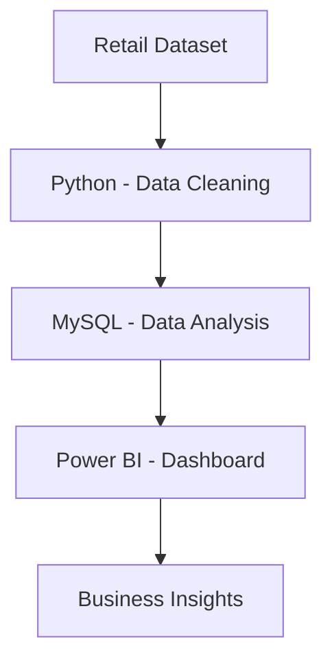

# 🛍️ Customer Shopping Behavior Analysis

### Turning Retail Data into Business Insights

  
  
  

## 📌 Project Overview

Analyzed **3,900 retail transactions** to understand customer purchasing patterns, spending behavior, product preferences, and subscription trends.

Used Python for data cleaning, MySQL for SQL analysis, and Power BI for dashboard visualization.

## 🎯 Objectives

- Identify customer purchasing patterns.
- Analyze revenue across product categories and demographics.
- Understand discount and shipping trends.
- Evaluate customer subscription behavior.
- Generate actionable business recommendations.

## 🛠️ Tech Stack

| Technology | Application |
|---|---|
|  **Python** | Data cleaning and preprocessing |
|  **Pandas** &  **NumPy** | Data manipulation |
|  **MySQL** | SQL queries and analysis |
|  **Power BI** | Dashboard and visualization |

## 🔄 Project Workflow

## 📊 Key Performance Indicators

| Metric | Result |
|---|---:|
| Total Transactions | 3,900 |
| Average Purchase | $59.76 |
| Average Rating | 3.75 |
| Subscription Rate | 27% |
| Total Revenue | ~$233K |

## 🔍 Key Insights

- **Customer Subscription:** 27% subscribed, while 73% were non-subscribers.
- **Revenue by Gender:** Male customers generated $157,890 and female customers $75,191.
- **Product Categories:** Clothing generated the highest revenue, while Outerwear generated the lowest.
- **Discounts:** Hats (50%) and Sneakers (49.66%) had the highest discounted purchase shares.
- **Shipping:** Express customers spent slightly more ($60.48) than Standard customers ($58.46).

## 🏁 Conclusion

This project demonstrates how **Python, MySQL, and Power BI** can transform raw retail data into meaningful insights, helping businesses improve customer engagement, marketing strategies, and sales performance.
